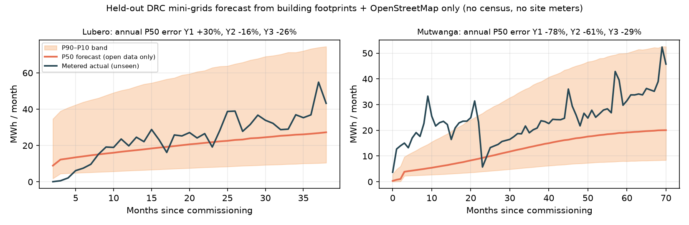

# Lodestar: bankable demand forecasts for mini-grids

**What P90 energy-yield reports did for solar project finance, Lodestar does for mini-grid demand.**

**Live app: https://lodestar-utfz.onrender.com** (free tier: the first load after idle can take about 30–60 s to wake up)

Pick any unelectrified village in Africa. Lodestar returns:

- a monthly demand forecast with a **P90 / P50 / P10 range**;
- a **5-year growth curve**, split into connections × consumption per connection;
- the **drivers in plain language**, each tagged as calibrated, benchmark or assumption;
- a daily **load profile** and **system size**, with an 8760-hour load file for HOMER/REopt;
- a **lender stress test** run across every Monte Carlo demand draw: viability gap (grant needed), debt that is safe on P90 demand, and covenant breach risk if debt is sized on P50 instead;
- a one-click **lender memo** that is a deterministic template, with no language model involved.

All of it is built **on open data only**, and validated **against real metered mini-grids**.

> Global Energy Hackathon 2026 · Problem Brief 03 "Predict mini-grid demand before building" · Track 2, Digital Solutions & AI · Setting B (non-residential: developers, lenders, RBF programmes)

---

## Validation against real meters

The organisers confirmed that no partner meter data would be provided for this brief. We used a public, CC0 metered panel instead: three mini-grids in North Kivu, DRC, with monthly connections and kWh from 2019 to 2024 ([Lunanga, Stoop, Verpoorten & Desbureaux 2026](https://doi.org/10.7910/DVN/KPDREF)).

**The headline test uses open data only, on held-out sites.** For the two village-scale sites (Lubero and Mutwanga), the forecast uses building footprints and OpenStreetMap only. It sees no census and none of the site's meter data. The footprint-to-customer ratios and growth shapes come from the *other* sites only.

| | Result |
|---|---|
| Metered annual energy inside the P90–P10 band | **5 of 6 site-years (83%)**, target 80% |
| Metered months inside the P90–P10 band | **81%** |
| Year-3 (sizing year) P50 error | **−26% (Lubero), −29% (Mutwanga)** |
| Mean absolute annual error, years 1–3 | 40% |



What it does **not** show, stated plainly:

- **Two village sites is method validation, not proof.** Every forecast Lodestar issues is pre-registered in a public ledger (`data/ledger/forecasts.jsonl`) so it can be scored when meters report.
- **A flat desk estimate that needs a census** had 36% annual error on the same two sites. It gives no range, and it missed the urban Goma network by 88%. We report it rather than hide it.
- **Learning from a site's own meters (Demand Bureau update)** helps early. Sharing the first 6 metered months cuts error on the following months from 40% to 35%, with 77% band coverage. That beats carrying the last month forward (52%). After 12 months, Mutwanga's conflict-driven consumption collapse makes persistence better (31% vs 47%). Consecutive months are strongly autocorrelated (lag-1 ρ = 0.93 for connections, 0.66 for kWh per connection), so the update discounts them by the effective sample size.
- **Goma** is a city network of about 16,700 potential customers, outside the village scope. It is reported for transparency.

Published reference points, measured differently: survey-based estimates miss individual customers by 65% ([CrossBoundary Innovation Lab](https://crossboundary.com/innovation-insight-machine-learning-to-predict-mini-grid-consumption/)). Site-level ML trained on many metered sites reached 37% per site (Allee et al., Tanzania).

Reproduce with `python scripts/validate_drc.py`. It writes `data/derived/validation.json` and the figures in `docs/validation/`.

## How it works

```
E(t) = Σ_segments  N_s · R_s / (1 + e^(−k_s (t − t0_s)))  ×  Q_s · (1 − a_s · e^(−t/τ_s))  +  anchor loads
```

- **N, potential customers:** from building footprints (VIDA merge of Google, Microsoft and OSM Open Buildings). The households-per-building and firms-per-large-building ratios are calibrated against the DRC census.
- **Ramp shapes:** connection uptake *R, k, t0* and appliance acquisition *a, τ* are fitted on the metered DRC panel.
- **Mature consumption levels *Q*:** AMDA *Benchmarking Africa's Minigrids 2024*, by region.
- **Anchors:** schools and clinics (RAMP SSA archetypes) and mills (an assumption, with wide uncertainty), counted from OpenStreetMap.
- **Uncertainty:** 20,000 Monte Carlo draws. Prior spreads are floored so that held-out P90–P10 coverage is about 80%.
- **Demand Bureau update:** shared metered months re-weight the draws. The level is integrated out analytically, and the shapes are importance-sampled with tempering.
- **Sizing and finance:** PV is sized on worst-month NASA POWER irradiance and the battery on night-time energy. CAPEX ($/kWp), OPEX ($/customer) and tariffs come from AMDA 2024. Each draw runs through a 20-year cash flow.

## The Demand Bureau: safe meter-data sharing

The Demand Bureau is a give-to-get data pool, modelled on credit bureaus:

- **What is shared:** site-month aggregates only (`site_hash, country, admin1, months_since_cod, conn_household, conn_sme, kwh_per_household, kwh_per_sme`). No customer-level data.
- **k-anonymous release:** a regional benchmark is published only when it pools at least 3 sites from at least 2 operators.
- **Federated option:** an operator can share fitted parameters instead of raw series.
- **Steward:** a neutral sector body.
- **Try it:** the app's Demand Bureau tab, or `POST /api/sites/{id}/bureau` with a CSV.

## Run it

```bash
uv venv && uv pip install -r requirements.txt
uvicorn api.main:app --port 8000          # http://localhost:8000
python scripts/validate_drc.py            # validation figures and metrics
python pipeline/select_sites.py --state NG:kn --max-candidates 2   # add villages (OSM + footprints + NASA POWER)
python scripts/precompute.py              # rebuild the index, reports and ledger
```

It runs on a laptop. Deploy with `render.yaml` (free tier). No API keys are needed.

| Endpoint | |
|---|---|
| `GET /api/sites` | demo villages and validation sites |
| `GET /api/sites/{id}/report` | full forecast JSON |
| `POST /api/forecast {lat, lon}` | forecast any location (fetches footprints, OSM and NASA POWER live, 2–5 min) |
| `POST /api/sites/{id}/bureau` | update with metered site-months (CSV) |
| `GET /api/sites/{id}/memo` | lender memo (print to PDF) |
| `GET /api/sites/{id}/load-8760.csv` | hourly load for HOMER/REopt |
| `GET /api/validation`, `GET /api/ledger` | backtest results; pre-registered forecasts |

## Repository

```
lodestar/   growth model, Monte Carlo + Bayesian update, priors, village engine, finance, report, ledger
pipeline/   feature extraction (footprints, OSM, GridFinder, NASA POWER) and site selection
api/        FastAPI app + lender memo template
web/        single-page app (MapLibre GL, Chart.js)
scripts/    validation, grid clipping, precompute
data/       DRC metered panel (CC0), site features, reports, ledger, small geo indexes
docs/       validation figures, one-pager, deck
```

## Data and licences

| Data | Source | Licence |
|---|---|---|
| Metered mini-grid panel | Lunanga et al. (2026), Energy Economics, doi:10.7910/DVN/KPDREF | CC0. The individual-level survey file is deliberately not redistributed. |
| Building footprints | VIDA Google-Microsoft-OSM Open Buildings (source.coop) | CC-BY-4.0 / ODbL |
| Schools, clinics, markets, mills, roads | © OpenStreetMap contributors | ODbL |
| Grid lines | GridFinder, Arderne et al. (2020), Zenodo 3628142 | CC-BY-4.0 |
| Solar resource | NASA POWER | public |
| Load shapes | RAMP SSA archetypes, Stevanato (2026), doi:10.5281/zenodo.22832973 | CC-BY-4.0 |
| Benchmarks | AMDA, *Benchmarking Africa's Minigrids* 2024 | cited, not redistributed |
| Satellite basemap (web) | Esri World Imagery | attribution shown in the app |

## Disclosure

Everything in this repository was built during the sprint (30 Oct – 1 Nov 2026). No prior code existed. Open-source libraries: FastAPI, NumPy, SciPy, pandas, GeoPandas, Shapely, pyproj, DuckDB, rasterio, Jinja2, Matplotlib, MapLibre GL and Chart.js. An AI coding assistant was used during development. The app itself uses no language model: every number and sentence in a report comes from the model and deterministic templates.
