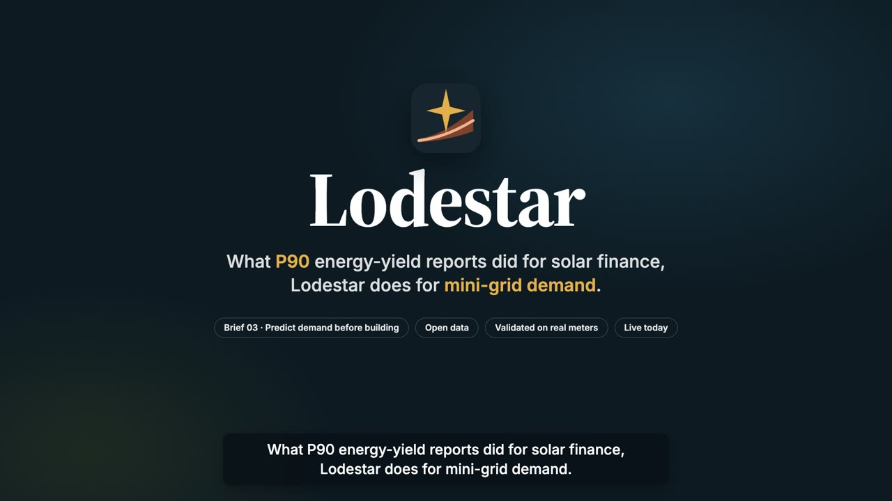
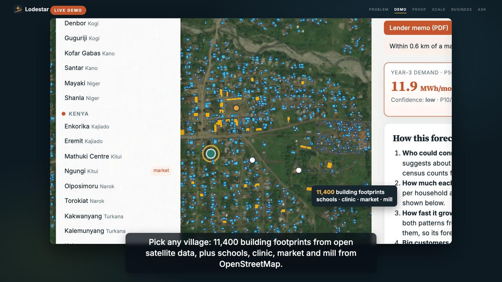
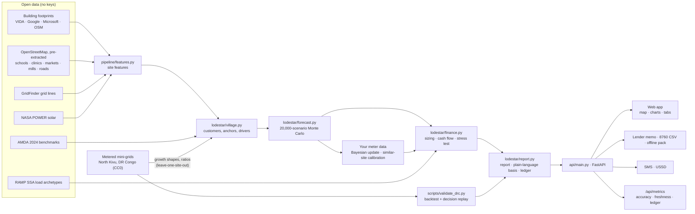
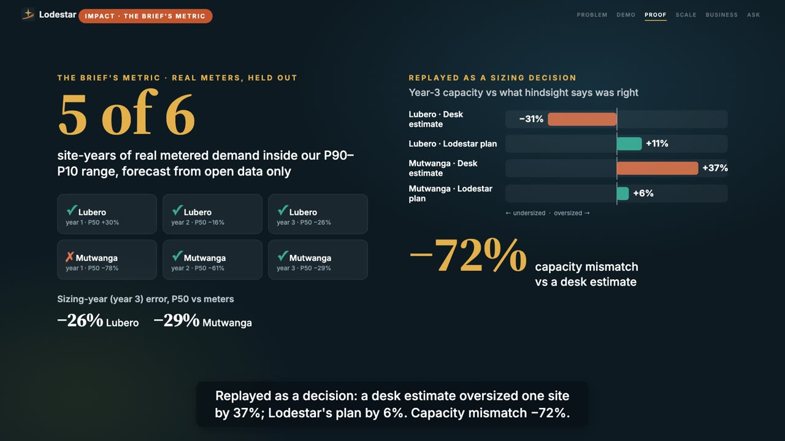

<p align="center"></p>

<h1 align="center">Lodestar</h1>
<p align="center"><b>Bankable demand forecasts for mini-grids, before anyone builds.</b><br>
What P90 energy-yield reports did for solar project finance, Lodestar does for mini-grid demand.</p>

<p align="center">Global Energy Hackathon 2026 · Problem Brief 03 "Predict mini-grid demand before building" · Track 2, Digital Solutions &amp; AI</p>

---

## Links

| | |
|---|---|
| **Live app** | **https://lodestar-utfz.onrender.com** (free hosting: the first visit after idle can take 30–60 s to wake up) |
| **Demo video (4:28)** | **https://youtu.be/KkYp2ROyTcs** |
| **Pitch video (3:05)** | **https://youtu.be/-O4Ev7trVAk** |
| Pitch deck (organisers' template, 5 slides) | [`docs/Lodestar_Brief03_Pitch.pdf`](docs/Lodestar_Brief03_Pitch.pdf) · editable [`.pptx`](docs/Lodestar_Brief03_Pitch.pptx) |
| One-page summary | [`docs/lodestar-one-pager.pdf`](docs/lodestar-one-pager.pdf) |
| A site forecast tested against real meters | https://lodestar-utfz.onrender.com/#explore/cd-nk-mutwanga |
| Example lender memo | https://lodestar-utfz.onrender.com/api/sites/cd-nk-mutwanga/memo |
| Validation results | [Validation tab](https://lodestar-utfz.onrender.com/#validation) · [raw JSON](https://lodestar-utfz.onrender.com/api/validation) · reproduce with `python scripts/validate_drc.py` |
| Track record (accuracy, forecast ledger, data freshness) | [Track record tab](https://lodestar-utfz.onrender.com/#ledger) · [`/api/metrics`](https://lodestar-utfz.onrender.com/api/metrics) |
| Impact, business model, buyer personas | [Impact tab](https://lodestar-utfz.onrender.com/#impact) |
| Portfolio screener + SMS/USSD demo | [Portfolio &amp; SMS tab](https://lodestar-utfz.onrender.com/#portfolio) |
| API reference (interactive) | https://lodestar-utfz.onrender.com/docs |
| Source code | https://github.com/TusharTechs/lodestar |

<p align="center"> </p>

## At a glance

| | |
|---|---|
| Real metered demand inside the P90–P10 range | **5 of 6** village site-years (target 80%), forecast from open data only, with none of the site's own meters |
| Year-3 (sizing year) error, P50 vs meters | **−26%** Lubero · **−29%** Mutwanga |
| Year-3 capacity vs hindsight, replaying real meter data | desk estimate **+37%** oversized → Lodestar plan **+6%** (Mutwanga); capacity mismatch **−72%** across both sites |
| Cost of power, right-sizing at P50 vs building for the optimistic case | **−48%** on average across 20 villages |
| Tariff needed with a Nigeria-style $600/connection results-based grant | **$0.20–0.40/kWh** for the viable sites, within AMDA's observed $0.24–0.40 |
| Compute and payload per forecast | **under 1 CPU-second**, about **6 KB**; open data, no API keys |
| Villages screened | **20** in Nigeria, Kenya and DR Congo; any other location on request, live |

## The problem

- **Scale:** 490 million people need the 217,000 mini-grids still to be built (ESMAP). Every one is sized before a single customer exists.
- **Today's estimates are poor:** survey-based estimates miss individual customers' demand by 65% (CrossBoundary Innovation Lab).
- **Oversizing is costly:** in CrossBoundary's 30 kW example, building twice too big drops project IRR from 12.5% to 6.1%.
- **Undersizing is costly too:** it means evening brownouts and backup diesel.
- **Finance stalls:** lenders cannot price a single-number guess, so sites are mis-sized or never financed.

## What Lodestar does

Pick any village and you get:

- **a demand range, not a point:** P90 / P50 / P10 monthly energy from 20,000 Monte Carlo scenarios;
- **growth over 5 years**, split into *connections ramp* × *consumption per connection*;
- **plain-language basis:** what the forecast is built from, with every input's source and date, and every driver tagged *calibrated*, *benchmark* or *assumption*;
- **a load profile and system size** (PV kWp, battery kWh), plus an 8760-hour load file for HOMER/REopt;
- **a lender stress test across every scenario:**
  - grant needed, and tariff needed with a results-based grant;
  - debt that stays safe on P90 demand, and covenant-breach risk if sized on P50;
  - cost of power for each sizing option;
- **a one-click lender memo:** a deterministic template, no language model;
- **any location in Nigeria, Kenya or DR Congo in about 10–20 seconds:** click the map; OpenStreetMap layers are pre-extracted, so only the building footprints are read live;
- **your own meter data:** upload metered months from *this* site (the forecast re-weights and the range tightens) or from a *similar site you already run* in another village or country (its consumption per customer replaces the regional benchmark). Files are processed in memory, not stored;
- **a portfolio screener:** each settlement is classified as mini-grid (bankable with an RBF grant, or needing an anchor load), solar home systems, or check grid extension;
- **field access:** a forecast in one 160-character SMS, a USSD menu in the Africa's Talking format, and a 12 KB offline site pack.

## Architecture



### How a forecast is made, in plain words

1. **Who could connect:** building footprints within 1.5–2 km give households and businesses. The buildings-to-customers ratios are calibrated on census counts from two metered mini-grid towns.
2. **How much each will use:** what African mini-grid customers actually use today (AMDA 2024, by region), adjusted for each village's drivers (wealth proxy, market, remoteness).
3. **How fast it grows:** connection ramps and appliance acquisition are learned from 38–70 months of monthly meter data. A metered site's own forecast learns only from the *other* sites.
4. **Big customers:** schools and clinics use published load profiles (RAMP). Mills are a stated assumption with wide uncertainty.
5. **How sure we are:** 20,000 scenarios vary every uncertain input. P90 is the level demand beats in 9 of 10 scenarios, the number to lend against.

```
E(t) = Σ_segments  N_s · R_s / (1 + e^(−k_s (t − t0_s)))  ×  Q_s · (1 − a_s · e^(−t/τ_s))  +  anchors
```

## Evidence it works

No partner meter data was available for this brief, so we used a public, CC0 metered panel: three mini-grids in North Kivu, DR Congo, with monthly connections and kWh, 2019–2024 ([Lunanga, Stoop, Verpoorten & Desbureaux 2026](https://doi.org/10.7910/DVN/KPDREF)).

**Open data only, held out.** Each village-scale site is forecast from building footprints and OpenStreetMap. The forecast uses no census and none of the site's own meters, and its calibration comes from the other sites only.


| | Lubero | Mutwanga |
|---|---|---|
| Year 1 / 2 / 3 P50 error | +30% / −16% / −26% | −78% / −61% / −29% |
| Year 1 / 2 / 3 inside P90–P10 | ✓ / ✓ / ✓ | ✗ / ✓ / ✓ |

**Learning from shared meters.** After an operator shares 6 metered months, error on the following months falls from 40% to 35% (band coverage 77%). That beats carrying the last month forward (52%). Consecutive months are autocorrelated, so the update discounts them by the measured effective sample size.

**Replayed as a sizing decision** (`lodestar/decision.py`). We compare a single desk-estimate build with Lodestar's plan: build at P50, then add 25% modules when 6 months of metered demand average over 90% of capacity.

<p align="center"></p>

**What this does not show:**
- **Two village sites is method validation, not proof.** Every forecast is pre-registered in a public ledger (`data/ledger/forecasts.jsonl`) and scored when meters report.
- **A census-based flat estimate scored 36%** on the same sites. It gives no range, and it missed the urban Goma network by 88%.
- **After 12 metered months, a conflict-driven collapse at Mutwanga** makes "carry the last month forward" more accurate than our update.
- **Trade-off in the decision replay:** Lodestar's plan invests more in total, because it serves Lubero demand the desk estimate missed, and it leaves more demand unserved at Mutwanga in year 1.

All of this is reported in the app.

## Who benefits, and who pays

| Buyer persona (scored 1–5) | Urgency | Value / ability to pay | Accessibility | Feeds the Demand Bureau | Role |
|---|---|---|---|---|---|
| Project head at a developer bidding for RBF-funded sites | 5 | 3 | 4 | 5 | **Primary** |
| Programme manager of an RBF window (e.g. Nigeria's DARES, 1,000+ planned mini-grids) | 4 | 5 | 2 | 5 | Secondary |
| Investment officer at a mini-grid debt fund or DFI | 3 | 4 | 2 | 2 | Later, after 12–18 months of scored forecasts |
| Household or shop owner in the village | — | — | — | — | Beneficiary, never a payer |

| Unit economics | |
|---|---|
| Price (proposed) | single-site forecasts free · **$300** Bankable Demand Report per site (0.05% of a ~$585k mini-grid) · **$12k/yr** portfolio screening |
| Cost (measured / assumed) | data $0 · under 1 CPU-second per forecast (measured) · hosting ~$300/yr · team ~$60k/yr (assumption: two analyst-engineers in Nairobi or Lagos) |
| Break-even | ~**200** reports a year, or 3 subscriptions + ~80 reports: about 3% of the 6,116 sites AMDA members plan |
| Cost per site at scale | marginal cost per extra site is close to zero; the 20-village portfolio takes about 15 CPU-seconds |
| Maintained locally | Python on a laptop, no GPU, no API keys; quarterly re-fit on Demand Bureau data; data freshness tracked against refresh targets |

The full business model canvas is on the [Impact tab](https://lodestar-utfz.onrender.com/#impact) and on slide 4 of the deck.

## Safe meter-data sharing: the Demand Bureau

- **Give-to-get**, as in credit bureaus: operators contribute site-month aggregates and receive regional benchmarks and narrower forecast ranges.
- **Shared fields:** `site_hash, country, admin1, months_since_cod, conn_household, conn_sme, kwh_per_household, kwh_per_sme`. No customer-level data, names or meter IDs.
- **k-anonymous release:** a regional figure is published only when at least 3 sites from at least 2 operators pool.
- **Federated option:** share fitted parameters, not series.
- **Steward:** a neutral sector body.

## Trust: the forecast ledger and the track record

- Every issued forecast is hashed (SHA-256) and timestamped before the site is built. Replaced forecasts are marked "superseded", never deleted.
- `/api/metrics` publishes accuracy against meters, ledger counts, and each data input's age against its refresh target.
- Inputs past their target are flagged **due**: GridFinder (2020) and the public meter panel (ends December 2024).

## Run it locally

Requirements: **Python 3.11 or 3.12**, about 1 GB of disk, and an internet connection for the map tiles. Tested on macOS and on Linux (the hosted app). Windows uses the same packages.

**macOS / Linux**

```bash
git clone https://github.com/TusharTechs/lodestar.git
cd lodestar
python3 -m venv .venv
source .venv/bin/activate
pip install -r requirements.txt
uvicorn api.main:app --port 8000
```

**Windows (PowerShell)**

```powershell
git clone https://github.com/TusharTechs/lodestar.git
cd lodestar
py -3.12 -m venv .venv
.venv\Scripts\Activate.ps1
pip install -r requirements.txt
uvicorn api.main:app --port 8000
```

(In Command Prompt, activate with `.venv\Scripts\activate.bat`. If PowerShell blocks the script, run `Set-ExecutionPolicy -Scope CurrentUser RemoteSigned` once.)

**With uv (any OS)**

```bash
uv venv && uv pip install -r requirements.txt
uv run uvicorn api.main:app --port 8000
```

Then open **http://localhost:8000**. Everything needed for the 20 demo villages and the validation is in the repository; no keys or accounts are needed.

| Optional task | Command |
|---|---|
| Re-run the validation (figures + `data/derived/validation.json`) | `python scripts/validate_drc.py` |
| Rebuild every report and the ledger | `python scripts/precompute.py --force` |
| Add villages in a state (OSM + footprints + NASA POWER) | `python pipeline/select_sites.py --state NG:kn --max-candidates 2` |
| Refresh the pre-extracted OSM layers (needs `pip install osmium`) | download `nigeria`, `kenya`, `congo-democratic-republic` `-latest.osm.pbf` from download.geofabrik.de/africa, then `python pipeline/osm_extract.py *.osm.pbf` |
| Lower memory use on small hosts | set `LODESTAR_DRAWS=8000` |

### API

| Endpoint | |
|---|---|
| `GET /api/sites` | demo villages and validation sites |
| `GET /api/sites/{id}/report` | full forecast JSON, including the plain-language basis |
| `POST /api/forecast` `{lat, lon}` | forecast any location in NG, KE, CD (about 10–20 s; footprints read live, OSM from the pre-extracted layers) |
| `POST /api/sites/{id}/bureau?mode=own\|analog` | your meter data: `own` re-weights with this site's metered months, `analog` calibrates on a similar site you run · blank CSV at `/api/bureau-template.csv` |
| `GET /api/sites/{id}/memo` · `/load-8760.csv` · `/pack.zip` | lender memo · hourly load for HOMER/REopt · offline site pack |
| `GET /api/portfolio` · `/api/personas` · `/api/economics` | screener · buyer personas · unit economics |
| `GET /api/validation` · `/api/metrics` · `/api/ledger` | backtest · service metrics · pre-registered forecasts |
| `GET /api/sms?site=…` · `POST /ussd` | SMS text · USSD menu |

## Project structure

```
lodestar/              forecasting engine
  forecast.py          Monte Carlo simulation and Bayesian update from metered months
  growth.py, priors.py growth curves, priors, benchmark levels
  village.py           footprints + OSM -> customers, anchors, explainable drivers
  finance.py           sizing, 20-year cash flow, stress test, cost of power, RBF tariff
  decision.py          sizing-decision replay on real metered demand
  report.py            report assembly, plain-language basis, forecast ledger
  economics.py, personas.py   unit economics and buyer personas
  drc.py               loader for the metered DR Congo panel
pipeline/              feature extraction (footprints, OSM, GridFinder, NASA POWER), site selection,
                       osm_extract.py: pre-extracts OSM POIs and major roads from Geofabrik files
api/                   FastAPI app and lender-memo template
web/                   single-page app (MapLibre GL, Chart.js), logo
scripts/               validation, precompute, grid clipping, pitch-deck builder
data/                  metered panel (CC0), site features and reports, ledger, small geo indexes
docs/                  pitch deck, one-pager, validation figures, images
render.yaml            one-click deploy on Render
```

## Data sources and licences

| Data | Source | Licence |
|---|---|---|
| Metered mini-grid panel | Lunanga et al. (2026), Energy Economics, doi:10.7910/DVN/KPDREF | CC0 (the individual-level survey file is deliberately not redistributed) |
| Building footprints | VIDA merge of Google, Microsoft and OSM Open Buildings (source.coop) | CC-BY-4.0 / ODbL |
| Schools, clinics, markets, mills, roads | © OpenStreetMap contributors (Geofabrik extracts of 2026-10-31 for new locations; type and location only) | ODbL |
| Grid lines | GridFinder, Arderne et al. (2020), Zenodo 3628142 | CC-BY-4.0 |
| Solar resource | NASA POWER | public domain |
| Load shapes | RAMP SSA archetypes, Stevanato (2026), doi:10.5281/zenodo.22832973 | CC-BY-4.0 |
| Benchmarks | AMDA, *Benchmarking Africa's Minigrids* 2024; ESMAP (2022); CrossBoundary Innovation Lab | cited, not redistributed |
| Satellite basemap | Esri World Imagery | attribution shown in the app |

## Open-source software

| Component | Used for | Licence |
|---|---|---|
| FastAPI, Uvicorn | API and server | MIT, BSD-3 |
| NumPy, SciPy, pandas | simulation and fitting | BSD-3 |
| GeoPandas, Shapely, pyproj, rasterio, DuckDB, PyArrow | geospatial features | BSD-3, BSD-3, MIT, BSD-3, MIT, Apache-2.0 |
| Jinja2, Matplotlib, requests | memo template, figures, data access | BSD-3, PSF-style, Apache-2.0 |
| MapLibre GL JS, Chart.js | map and charts | BSD-3, MIT |
| Inter, Source Serif 4 | typography | SIL OFL 1.1 |
| python-pptx, LibreOffice | building and checking the pitch deck | MIT, MPL-2.0 |
| Playwright, FFmpeg | recording and editing the demo video | Apache-2.0, LGPL/GPL |
| Kokoro-82M (via kokoro-onnx), espeak-ng | demo and pitch video narration voice | Apache-2.0, MIT, GPL-3.0 |

## AI disclosure

- **Development:** an AI coding assistant (Claude, by Anthropic) was used throughout the sprint, under the team's direction. It helped write and debug code, analyse the data and documents, draft the README, one-pager, deck text and video script, and research public sources.
- **Checks:** every number was checked against the code's output or a cited source, and the validation can be re-run with one command.
- **Video narration (demo and pitch):** a synthetic voice generated locally with the open-source Kokoro text-to-speech model. The on-camera intro is the founder.
- **The running app uses no AI model or LLM API.** Forecasts come from a statistical model fitted to public data, and memos and explanations are deterministic templates filled from the model's numbers.

## Built during the sprint

All code, data processing and documents were created during the 48-hour sprint (30 Oct – 1 Nov 2026); the git history starts after the sprint began. No prior work.

**Team Lodestar:** Tushar Agarwal (product, data and engineering).

## License

Code: [MIT](LICENSE). Each dataset keeps its own licence (see the data table above).
